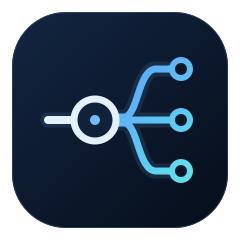
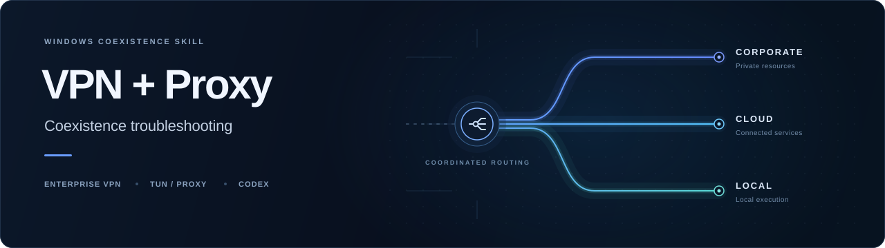

<p align="center">
  
</p>

<p align="center">
  
</p>

<h1 align="center">CoRoute</h1>

<p align="center">让企业内网、代理与本机连接各走其路</p>

<p align="center">
  <a href="skills/windows-vpn-proxy-coexistence/SKILL.md"></a>
  
  <a href="LICENSE"></a>
</p>

---

企业 VPN、Clash TUN 和系统代理同时开启时，网页可能一直加载，Codex 反复重连，dot 的电脑也可能显示离线。CoRoute 把一次成功排障中可复用的判断整理为 **Agent Skill**：先定位是哪条连接、哪一层出了问题，再采用有证据支持的修复。

适合 Windows 上的 iOA / 企业 VPN、Clash Verge Rev / Mihomo 共存问题。也可直接阅读文档，将方法用于手工排查。它不附带可一键导入的个人网络配置。

## 能解决什么

| 你遇到的现象 | Skill 帮助核查的重点 |
| --- | --- |
| 开启 TUN 后浏览器像断网 | DNS 监听争用、解析链、实际选路 |
| 公司域名已设置 DIRECT 仍打不开 | 系统代理绕过、WFP 与出口绑定 |
| Codex 可以聊天，dot 的电脑却离线 | 本机执行通道、长连接与 fake IP 路由 |
| 修改配置后没有生效或又变回去 | 活动增强、DNS 覆盖顺序与 UI 缓存 |

**三者同时开启并不必然冲突。** 公司网页、Codex 对话和 dot 本机操作是三个独立验收目标；一个成功不能代替另外两个。

## 安装与使用

仓库没有运行依赖或自动联网脚本。克隆仓库后，将其中的 Skill 目录复制到你的 Agent 支持的技能目录。

```bash
git clone https://github.com/Fu-uan/codex-network-coexistence.git
```

对于支持项目技能的 Codex，可在**你自己的目标项目**根目录用 PowerShell 安装。先输入仓库在你本机的实际路径；同名技能已存在时停止，不覆盖。

```powershell
$Source = Read-Host '仓库完整路径'
$Skill = 'windows-vpn-proxy-coexistence'
$SourceSkill = Join-Path $Source "skills/$Skill"
$Destination = Join-Path (Get-Location) ".agents/skills/$Skill"
if (-not (Test-Path -LiteralPath (Join-Path $SourceSkill 'SKILL.md'))) {
    throw '源目录中没有找到 Skill'
}
if (Test-Path -LiteralPath $Destination) {
    throw '同名技能已存在，请先核对，避免覆盖'
}
New-Item -ItemType Directory -Path (Split-Path $Destination -Parent) -Force | Out-Null
Copy-Item -LiteralPath $SourceSkill -Destination $Destination -Recurse
```

也可按当前 Codex 版本的[官方技能说明](https://developers.openai.com/codex/skills)安装到用户技能目录。其他 Agent 的发现路径可能不同，技能内容使用开放的 [Agent Skills 格式](https://agentskills.io/specification)。

调用示例：

```text
使用 $windows-vpn-proxy-coexistence 排查我的 Windows 网络。
企业 VPN、Clash TUN 和系统代理同时开启后，内网或 Codex/dot 连接不稳定。
先只读检查真实版本、DNS、代理绕过和路由，区分聊天与本机执行通道。
修改前备份；可能断开远程连接时，先安排本地恢复方式。
```

如果 Agent 不支持 Skill，直接向它提供 [SKILL.md](skills/windows-vpn-proxy-coexistence/SKILL.md)，并让它按需读取同目录 `references` 下的文档。

## 包含哪些内容

- [Skill 入口](skills/windows-vpn-proxy-coexistence/SKILL.md)：症状分流、修改边界和验收标准。
- [只读核查命令](skills/windows-vpn-proxy-coexistence/references/只读核查命令.md)：PowerShell 采样与证据的解释范围。
- [Windows 共存细节](skills/windows-vpn-proxy-coexistence/references/Windows共存细节.md)：DNS、WFP、代理绕过与版本限定的路由案例，附源码依据。

## 适用范围与验证边界

详细案例核对了 **Clash Verge Rev 2.4.7、Mihomo v1.19.21、sing-tun v0.4.16 与 iOA WFP 模式**。原案例在三者同时开启时通过了企业页面、Codex 对话、dot 在线及本机只读操作，并完成一次短时连接观察。

这不代表所有版本、VPN 模式或地址布局都适用。特别是文档中的保留 `/30` 路由方法，只针对已核实的 fake IP 服务布局与具体路由冲突；不能照抄为通用补丁。重启恢复、长期运行与其他版本未验证。

Skill 默认先诊断，不会自行执行脚本修改网络。自动恢复机制需由使用它的 Agent 在实际环境中准备，仓库没有预装恢复工具。

## 隐私与反馈

公开内容只使用产品名、开源版本、通用机制和保留示例地址。路由案例的地址已作等价替换；不包含原环境地址、真实企业域名、企业 IP、设备标识、本机目录、订阅、代理节点或原始日志。

提交 Issue 时，只提供版本、开关组合、脱敏后的最小症状与验证结果。不要上传完整配置、订阅链接、令牌、企业地址、电脑名或未经处理的日志和截图。请先在本机删除这些信息，再提交反馈。

## 来源与许可

本项目是独立的社区经验整理，与 OpenAI、腾讯、Clash Verge Rev 或 Mihomo 项目无隶属关系。

方法依据及固定版本源码链接见 [Windows 共存细节](skills/windows-vpn-proxy-coexistence/references/Windows共存细节.md#公开依据)。未复制上游实现代码。Skill 结构使用 [Agent Skills 规范](https://agentskills.io/specification)，README 图标与横幅为本仓库原创 SVG。

本仓库原创内容采用 [MIT License](LICENSE)。
